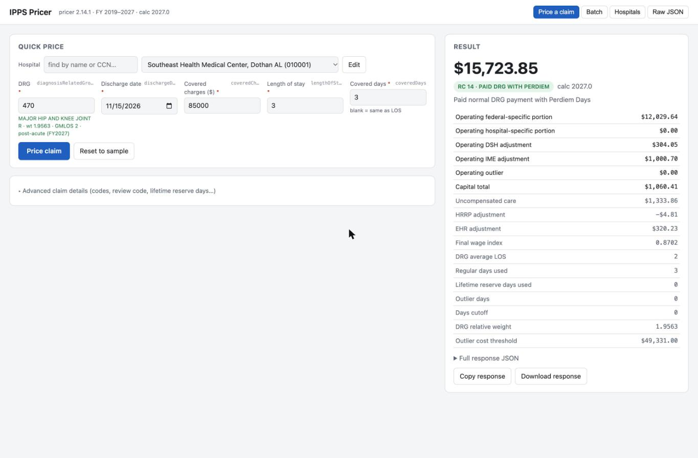
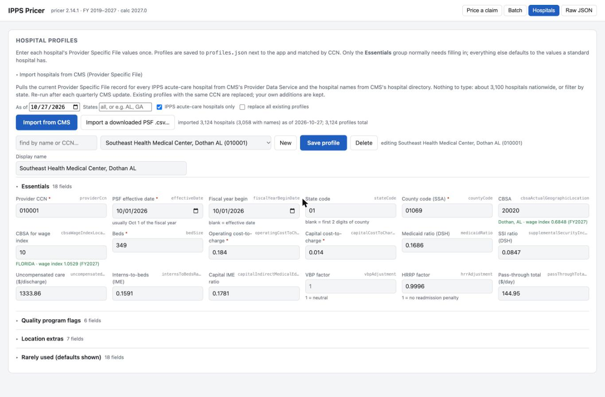
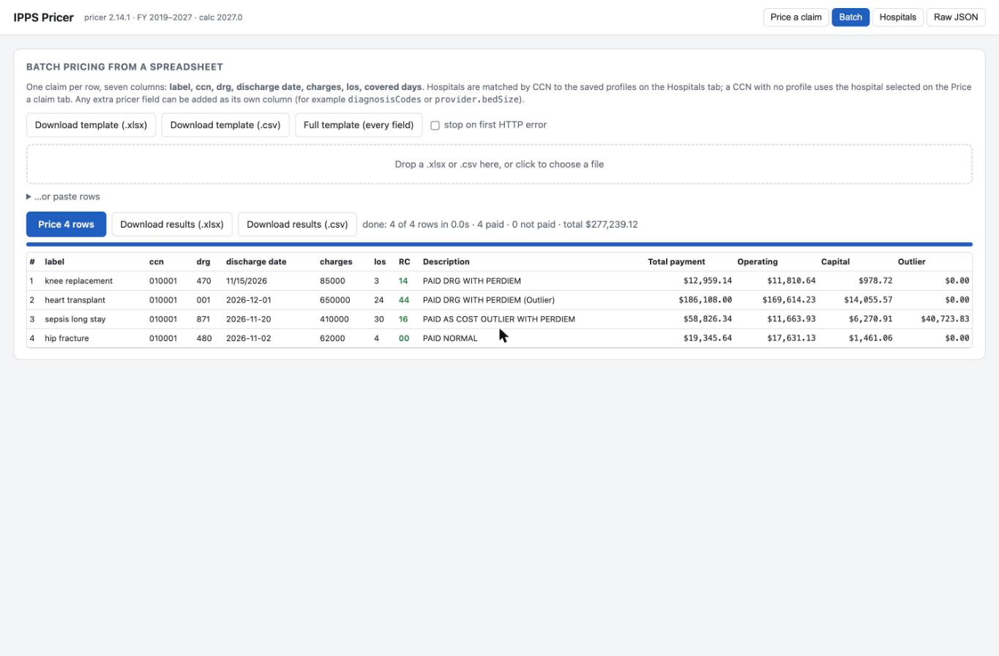

# IPPS Pricer

Local web interface for the CMS IPPS Pricer (FY2019–FY2027). See [ipps-pricer-ui/README.md](ipps-pricer-ui/README.md)
for setup, daily use, and notes on the pricer's behaviour.

Quick start (needs Java 17 and Python 3):

```bash
python3 ipps-pricer-ui/pricer_ui.py
```

## How to use

### 1. Price a single claim
Find the hospital by name or CCN, enter the DRG, discharge date, covered charges and length of stay, then press **Price claim**.
The DRG description and the hospital's wage index are looked up as you type. The result panel shows the total
payment, the pricer's return code, and the payment breakdown. Review code, lifetime reserve days and diagnosis or
procedure codes are under *Advanced claim details*.



### 2. Load the hospitals
On the **Hospitals** tab, open *Import hospitals from CMS* and press **Import from CMS**. The app downloads the current
Provider Specific File record for every IPPS acute-care hospital (about 3,100) from CMS's Provider Data Service, plus
hospital names from CMS's hospital directory, and saves them as profiles. Nothing to type. Filter by state if you only
need a few, and re-run after each quarterly CMS update. You can also add or edit a hospital by hand: press **New**,
fill in the *Essentials* group, and **Save profile**. Profiles live in `ipps-pricer-ui/profiles.json`, keyed by CCN.



### 3. Price a spreadsheet of claims
On the **Batch** tab, download the template, fill one row per claim (label, ccn, drg, discharge date, charges, los,
covered days), drop the file on the page and press **Price N rows**. Each row is matched to a hospital by CCN.
Files are priced on the server with parallel workers, so size is not a concern: 50,000 claims take about 10 seconds.
The page shows progress, a summary (paid / not paid / rejected counts and total payment) and the first 300 rows;
the .xlsx and .csv downloads contain every row. Click any row in the table to see that claim's full response.
Result files are kept in `ipps-pricer-ui/batches/` until you delete them.



## Data sources
- **Pricer**: CMS IPPS Pricer v2.14.1 (the jar in `ipps-pricer-ui/`), which carries the DRG weights and CBSA wage-index tables for FY2019–FY2027.
- **Hospital records**: CMS Provider Specific File, from the Provider Data Service export at
  `https://pds.webpricer.cms.gov/fiss/inpatient/export` (CSV; one record per provider per effective date).
  The import keeps, for each CCN, the latest record effective on or before the *as of* date, and only hospitals the
  IPPS pricer applies to (CCN sequence 0001–0879 with capital payment code B or C).
- **Hospital names**: CMS Hospital General Information dataset (data.cms.gov provider data), cached for a day in
  `ipps-pricer-ui/hospital-names.json`.
- A hospital whose newest PSF record predates the fiscal year you are pricing (CMS publishes some late) can return
  return code 52 (invalid wage index) until the next quarterly update; re-run the import then.
